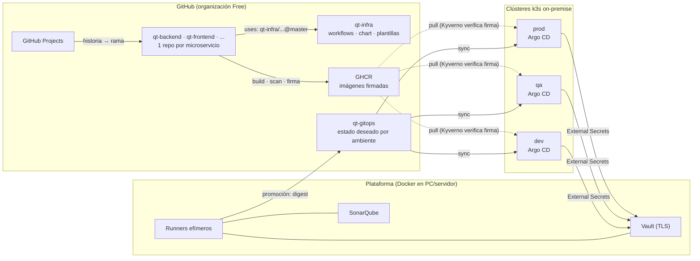

# qt-infra: plataforma CI/CD + GitOps 100 % gratuita

Plataforma corporativa para microservicios: **un repositorio por microservicio**, **tres ambientes (dev · qa · prod) en tres clústeres Kubernetes on-premise (k3s)**, CI/CD en **GitHub Actions** y despliegue **GitOps con Argo CD**. Todo con herramientas gratuitas u open source.

Este repo es la plataforma: workflows reutilizables, chart común, plantillas de microservicio, aprovisionamiento de clústeres y servicios de soporte (Vault, SonarQube, runners).

## Qué reemplaza a qué

| Necesidad corporativa | Herramienta típica (paga) | Aquí (gratis) |
|---|---|---|
| Gestión de historias | Jira | **GitHub Projects** (tablero de la organización) + Issue Forms |
| CI/CD | Jenkins / Azure DevOps | **GitHub Actions** (workflows reutilizables + runners self-hosted efímeros) |
| Despliegue | Spinnaker / Octopus | **Argo CD** (GitOps) en cada clúster |
| Kubernetes on-premise | OpenShift / Rancher | **k3s** aprovisionado con **Ansible** |
| ConfigMaps / Secrets | — | ConfigMap desde `qt-gitops` · Secret desde **Vault** vía **External Secrets** |
| Calidad | SonarQube Developer | **SonarQube Community** + plugin de ramas/PRs |
| SAST | Checkmarx | **Semgrep** + **CodeQL** |
| SCA / artefactos | JFrog Xray | **Trivy** + **Dependency-Track** + Dependency Review |
| Secretos | CyberArk / Vault Enterprise | **HashiCorp Vault** (TLS, OIDC de GitHub, auth Kubernetes) |
| Registro de artefactos | Artifactory | **GHCR** (imágenes) + **GitHub Releases** (binarios) |
| Supply chain | Xray + firma propia | SHA-256 en cada etapa, **cosign**, **SLSA**, SBOM y **Kyverno** (solo imágenes firmadas) |
| Gobierno | Bitbucket DC | Rulesets: `master` intocable, aprobación de un admin y auto-merge |
| Observabilidad | Datadog / Dynatrace | **Grafana + Prometheus + Loki + Alloy** en cada clúster (dev, qa, prod), con dashboard y alertas de microservicios |
| Alta de microservicios | Backstage / tickets manuales | Workflow **Nuevo microservicio** (backend o frontend) con aprobación de admins |

## Arquitectura



**Promoción:** merge a `master` → **dev**. Release (`vX.Y.Z`) → **qa**. El mismo digest pasa a **prod** con la aprobación de un admin. Si Argo CD no queda *Healthy*, el pipeline revierte el commit GitOps.

## Estructura

```
.
├── .github/workflows/
│   ├── service-ci.yml · service-cd.yml           ← los usan TODOS los microservicios
│   ├── service-pr-lint / -governance / -project / -codeql.yml · gitops-ci.yml
│   ├── _build · _security · _sonar · _image · _promote.yml   (internos)
│   └── ci.yml · infra-checks.yml · ...            CI propio de qt-infra
├── k8s/
│   ├── charts/qt-service/      chart común: Deployment, Service, Ingress, ConfigMap, ExternalSecret, HPA, PDB, NetworkPolicy
│   ├── charts/cluster-config/  por clúster: ClusterSecretStore (Vault) + política de imágenes firmadas (Kyverno)
│   ├── charts/observability/   por clúster: admin de Grafana desde Vault, dashboard y alertas de microservicios
│   └── provisioning/           Ansible: k3s en tus servidores (inventarios dev, qa, prod)
├── templates/
│   ├── service-quarkus/        backend Java 21 + Quarkus: esqueleto + deploy/ (properties, recursos, HPA, Vault por ambiente)
│   ├── service-angular/        frontend Angular: esqueleto + deploy/ (config.json, recursos, HPA por ambiente)
│   ├── _common/                workflows, gobierno e issue forms de cada repo nuevo
│   └── gitops/                 contenido inicial de qt-gitops
├── platform/                   Vault · SonarQube · runners · Dependency-Track · toolbox (qt.ps1 / qt.sh)
├── scripts/new-service.sh      crea un microservicio completo con un comando
└── docs/
```

## Empezar

1. **[docs/puesta-en-marcha.md](docs/puesta-en-marcha.md)**: organización, plataforma, clústeres y primer microservicio.
2. **[docs/flujo-de-trabajo.md](docs/flujo-de-trabajo.md)**: el día a día (historia → PR → dev → qa → prod) y cómo cambiar configuración o secretos.
3. **[docs/seguridad.md](docs/seguridad.md)**: secretos, supply chain, políticas del clúster y límites conocidos.
4. **[docs/observabilidad.md](docs/observabilidad.md)**: Grafana, métricas, logs y alertas por ambiente.

```powershell
cd platform
.\qt.ps1 up                                   # Vault (TLS) + SonarQube + runners
.\qt.ps1 github-app <APP_ID> <CLIENT_ID> app.pem
.\qt.ps1 ssh-key                              # llave para tus servidores
.\qt.ps1 k8s-provision dev                    # k3s en los servidores de dev (igual qa y prod)
```
```bash
bash platform/scripts/github-bootstrap.sh     # organización + qt-infra + qt-gitops (Git Bash)
```
```powershell
.\qt.ps1 k8s-bootstrap dev                    # Vault ⇄ clúster + Argo CD + GitOps (igual qa y prod)
```
Microservicios: **Actions → Nuevo microservicio** en `qt-infra` (o, en local, `bash scripts/new-service.sh qt-backend backend`).

## Costos y límites

- **USD 0** con repos públicos en una organización GitHub Free. En repos privados, la protección de ramas, el auto-merge y los environments con aprobación requieren GitHub Team.
- Los jobs que usan Vault, SonarQube o Argo CD corren en los **runners self-hosted**: si la máquina de la plataforma está apagada, esperan en cola (hasta 24 h).
- Vault corre en un solo nodo con auto-unseal local, apto para laboratorio u on-premise pequeño (ver [seguridad](docs/seguridad.md)).
