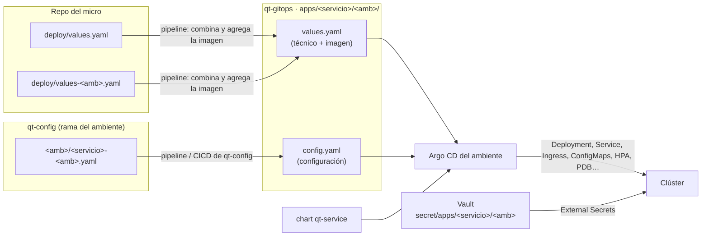

# Despliegues

Qué archivo define qué cosa de un microservicio, cómo se combinan y cómo llega cada pieza al clúster.

## Dónde vive cada cosa

Un microservicio se describe en **tres lugares**. Cada uno tiene una responsabilidad y no se pisan:

| Lugar | Qué define | Quién lo cambia | Cambiarlo requiere |
|---|---|---|---|
| Repo del micro: **`deploy/`** | Lo **técnico**: cómo corre (puerto, probes, ruta, observabilidad, recursos, escalado) | El equipo del micro, en su historia `qt/<n>` | Una versión nueva (pasa por DEV → cert → prod) |
| Repo del micro: **`application.properties`** (backend) | La configuración **base** del código, igual para todos los ambientes | El equipo del micro | Una versión nueva |
| Repo **qt-config**: `<ambiente>/<servicio>-<ambiente>.yaml` | La **configuración del ambiente**: variables, archivos (`application.properties`, `config.json`) y nombres de secretos | PR en qt-config (rama del ambiente) | Solo el PR: **no** necesita versión nueva |
| **Vault** `secret/apps/<servicio>/<ambiente>` | Los **valores** de los secretos | Un admin (`.\qt.ps1 secret-set`) o la plataforma (`generate: true`) | Nada más |

El **chart común** (`qt-infra/k8s/charts/qt-service`) convierte todo eso en los manifiestos de Kubernetes. Su [`values.yaml`](../k8s/charts/qt-service/values.yaml) tiene los valores por defecto y la referencia completa de cada opción.

---

## La carpeta `deploy/`

```
deploy/
├── values.yaml        ← COMÚN a los 3 ambientes
├── values-dev.yaml    ← solo dev
├── values-cert.yaml   ← solo cert
├── values-prod.yaml   ← solo prod
└── README.md
```

**Los cuatro archivos se usan, no son documentativos.** En cada despliegue el pipeline combina `values.yaml` + `values-<ambiente>.yaml` (el del ambiente gana si repite una clave) y publica el resultado en `qt-gitops/apps/<servicio>/<ambiente>/values.yaml`, que es lo que lee Argo CD.

### `deploy/values.yaml`: lo común

| Clave | Qué es | Backend (Quarkus) | Frontend (Angular) |
|---|---|---|---|
| `containerPort` | Puerto del contenedor | `8080` | `8080` |
| `probes.liveness` / `probes.readiness` | Rutas de *health* que usa Kubernetes para saber si el pod vive y si puede recibir tráfico | `/q/health/live` · `/q/health/ready` | `/healthz` · `/healthz` |
| `ingress` | Ruta pública: `<subdomain>.<dominio del ambiente><path>` | `subdomain: qt`, `path: /api` | `subdomain: qt`, `path: /` |
| `metrics` | Métricas para Prometheus (crea el *ServiceMonitor*) | `enabled: true`, `/q/metrics` | `enabled: false` |
| `observability.tracing` | Trazas OpenTelemetry → Tempo | `true` | `false` |
| `observability.grafana` | Métricas y logs visibles en Grafana | `true` | `false` (su salud la vigilan los probes) |
| `configFiles.mountPath` | Dónde se montan los archivos que vienen de qt-config | `/deployments/config` | `/usr/share/nginx/html/runtime` |
| `requiredConfig` | Lo que **esta versión** necesita encontrar en qt-config (variables, archivos, secretos). DEV, el congelamiento y el pase lo verifican **antes** de desplegar | `files: [application.properties]` | `files: [config.json]` |

**Observabilidad:**

| | `tracing: true` | `tracing: false` |
|---|---|---|
| Qué pasa | La plataforma inyecta `QUARKUS_OTEL_EXPORTER_OTLP_ENDPOINT` (Tempo) y `OTEL_RESOURCE_ATTRIBUTES` (ambiente). Cada petición genera una traza | Inyecta `QUARKUS_OTEL_SDK_DISABLED=true`: no se generan trazas ni se gasta CPU o memoria en ellas |

| | `grafana: true` | `grafana: false` |
|---|---|---|
| Qué pasa | Prometheus recoge sus métricas (si `metrics.enabled`) y Alloy envía sus logs a Loki | Sin *ServiceMonitor*; el pod lleva la etiqueta `qt.platform/logs: "false"` y Alloy descarta sus logs. Siguen disponibles con `kubectl logs` |

Para cambiarlo en **un solo ambiente** (p. ej. trazas solo en dev), pon el bloque `observability` en `values-<ambiente>.yaml`.

### `deploy/values-<ambiente>.yaml`: por ambiente

El **plan de recursos** y el **escalado** de cada ambiente:

| Clave | Qué es |
|---|---|
| `replicaCount` | Réplicas fijas (cuando no hay HPA) |
| `resources.requests` | CPU y RAM **reservadas** en el nodo para cada pod |
| `resources.limits` | **Tope** por pod. Si supera la memoria, Kubernetes lo reinicia (*OOMKilled*) |
| `autoscaling` (HPA) | Escalado horizontal: `minReplicas`, `maxReplicas`, % de CPU/memoria objetivo, tiempo de estabilización antes de bajar réplicas |
| `podDisruptionBudget` | Mínimo de pods que siguen arriba durante un mantenimiento de nodos |
| `spreadAcrossNodes` | Reparte las réplicas en nodos distintos |

Valores con los que nace un micro (se ajustan según su consumo real; ver [recursos.md](../docs/recursos.md)):

| | dev | cert | prod |
|---|---|---|---|
| **Backend** recursos (requests → limits) | 100m / 256Mi → 500m / 512Mi | 250m / 384Mi → 1 CPU / 768Mi | 500m / 512Mi → 1,5 CPU / 1Gi |
| **Backend** escalado | 1 réplica | HPA 1–3 (CPU 75 %) | HPA 2–6 (CPU 70 %, memoria 80 %) · PDB · repartido en nodos |
| **Frontend** recursos | 10m / 32Mi → 200m / 64Mi | 20m / 32Mi → 300m / 96Mi | 50m / 48Mi → 500m / 128Mi |
| **Frontend** escalado | 1 réplica | 1 réplica | HPA 2–4 (CPU 70 %) · PDB · repartido en nodos |

### Lo que **no** va en `deploy/`

Variables, archivos de configuración y secretos van en **qt-config**. Si alguien los pone en `deploy/` (`config:`, `configFiles.files:`, `secrets.enabled:`), el pipeline los **descarta** al componer: la configuración de un ambiente tiene una sola fuente.

---

## qt-config: la configuración de cada ambiente

Un archivo por micro y ambiente, cada ambiente en su rama:

| Ambiente | Rama de qt-config | Archivo |
|---|---|---|
| dev | `pre-develop` | `dev/<servicio>-dev.yaml` |
| cert | `develop` | `cert/<servicio>-cert.yaml` |
| prod | `master` | `prod/<servicio>-prod.yaml` |

| Sección | Qué va | Llega al pod como |
|---|---|---|
| `env:` | Variables de entorno **no secretas** | ConfigMap `<servicio>-config` → variables de entorno |
| `files:` | Archivos completos: `application.properties` (backend) o `config.json` (frontend) | ConfigMap `<servicio>-files` montado en `configFiles.mountPath` |
| `secrets:` | **Solo los nombres** de los secretos. `generate: true`: la plataforma crea un valor aleatorio distinto por ambiente. `generate: false`: lo carga un admin | Secret (External Secrets desde Vault) → variables de entorno |

Al mergear un PR en qt-config, su propio CICD lo aplica en el ambiente de esa rama, espera a Argo CD y **revierte solo** si el micro no queda sano. Los cambios suben de ambiente en orden (dev → cert → prod) con PRs de promoción. Detalle: [configuracion.md](../docs/configuracion.md).

Un frontend (SPA) no usa `env:` ni `secrets:`: todo lo que llega al navegador es público. Su configuración es `config.json`, que la app lee al iniciar en `/runtime/config.json`. Así **la misma imagen** sirve en los 3 ambientes.

---

## `application.properties` (backend)

El de `src/main/resources/` es la **base**: va dentro de la imagen y es igual en todos los ambientes. Lo propio de cada ambiente llega desde qt-config, así que este archivo **cambia poco** después de crear el micro.

**Prioridad** (gana el de arriba):

1. Variables de entorno: `env:` y `secrets:` de qt-config, más las que pone la plataforma.
2. `config/application.properties` del ambiente: `files:` de qt-config, montado en `/deployments/config/`.
3. `src/main/resources/application.properties` del repo.

| Va en el `application.properties` del repo | Va en qt-config (`files: application.properties`) |
|---|---|
| Propiedades de **build**, que no se pueden cambiar en runtime: `quarkus.http.root-path`, extensiones | Niveles de log del ambiente |
| Valores por defecto comunes: nombre de la app, formato de log con `traceId`, health y métricas en `/q` | URL de la base de datos, de otros servicios, CORS del ambiente |
| Perfiles **locales** `%dev` (tu máquina) y `%test` (tests). No son los ambientes del clúster | Cualquier propiedad de runtime que cambie entre dev, cert y prod |

Si el código empieza a usar una propiedad, variable o secreto **nuevo**:

1. Agrégalo en `requiredConfig` de `deploy/values.yaml`.
2. Créalo en qt-config en cada ambiente **antes** de desplegar ahí. Si falta, el despliegue se frena con un mensaje que dice qué falta.

### Variables que pone la plataforma (no se declaran)

| Variable | Valor |
|---|---|
| `QT_SERVICE` | Nombre del micro |
| `QT_ENVIRONMENT` | `dev`, `cert` o `prod` |
| `QT_VERSION` | Versión desplegada: `sha-<commit>` en dev, `vX.Y.Z-rc.N` en cert y prod |
| `QUARKUS_OTEL_EXPORTER_OTLP_ENDPOINT`, `OTEL_RESOURCE_ATTRIBUTES` | Con `observability.tracing: true` |
| `QUARKUS_OTEL_SDK_DISABLED=true` | Con `observability.tracing: false` |

La imagen (repositorio, *digest* SHA-256 y tag) también la escribe el pipeline; nunca se edita a mano.

---

## Cómo se combina todo



Argo CD aplica el chart con, en orden de prioridad creciente: los valores por defecto del chart → `values.yaml` (técnico) → `config.yaml` (configuración).

## Cuándo se despliega

| Ambiente | Cuándo | Aprobación |
|---|---|---|
| **dev** | Cada push a la rama de la historia `qt/<n>` | Ninguna |
| **cert** | Al mergear el PR a `master`: **congelamiento** (congela, prueba la reversión y vuelve a congelar) | La del PR |
| **prod** | **Pase** agendado con `/agendar` en la historia, a la hora indicada. Después se ratifica (`/ratificar`) o se revierte (`/revertir`) | Un admin aprueba el pase |

Si un despliegue falla, el pipeline **revierte** a la versión anterior y muestra el diagnóstico (estado de los recursos, eventos y últimas líneas de log) en el resumen del workflow. Detalle: [flujo-de-trabajo.md](../docs/flujo-de-trabajo.md).

## Qué cambio va dónde

| Quiero… | Dónde | ¿Versión nueva? |
|---|---|---|
| Más CPU/RAM o réplicas en prod | `deploy/values-prod.yaml` | Sí |
| Activar o apagar trazas o Grafana | `deploy/values.yaml` (o `values-<amb>.yaml` para uno solo) | Sí |
| Cambiar una ruta de health o el path público | `deploy/values.yaml` | Sí |
| Cambiar un nivel de log o la URL de un servicio en cert | qt-config `cert/<servicio>-cert.yaml` (rama `develop`) | No |
| Agregar un secreto nuevo | Nombre en qt-config `secrets:` + `requiredConfig` en `deploy/values.yaml`; valor en Vault | Sí (por el código que lo usa) |
| Rotar el valor de un secreto | `.\qt.ps1 secret-set` o `secret-generate`. External Secrets actualiza el Secret en ≤ 15 min, pero el pod lo lee al **reiniciar**: `kubectl rollout restart deploy/<servicio> -n <servicio>` o el próximo despliegue | No |
| Cambiar el `config.json` del frontend en prod | qt-config `prod/<servicio>-prod.yaml` (rama `master`) | No |
